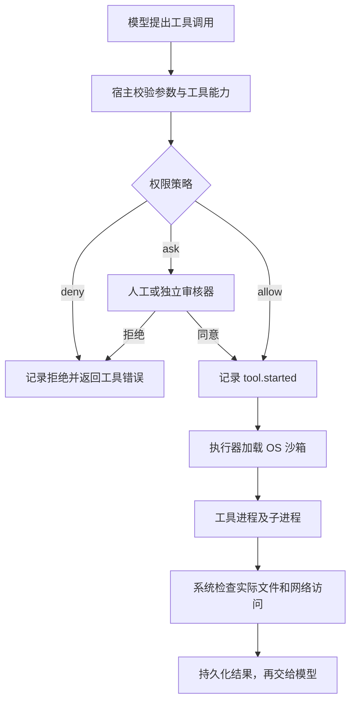

# 第二讲：Agent 的授权、批准和沙箱怎样协作

研究与实现日期：2026-10-15。由 [统一 TODO 中的权限模式课题](../TODO.md)展开，代码位于 [agent-harness](../../projects/agent-harness/README.md)。

## 从“只读”这个要求推导

假设我们要求 Agent 只能读文件。第一步可以在工具注册处禁止 `write_file`。但如果它还可以调用 `exec`，执行 `node -e 'require("fs").writeFileSync(...)'`，写入依然会发生。把工具叫作“运行测试”也不会改变这一点：测试脚本、依赖安装脚本和构建插件都可能写文件、联网、启动子进程。

因此，一个可执行的权限设计至少要回答三个不同的问题：

1. **允许的范围是什么？** 哪些文件可读写，是否可以联网，哪些业务对象属于当前用户？
2. **这次动作需要谁同意？** 自动允许、用户批准、独立审核器判断，还是直接拒绝？
3. **由谁强制执行？** 工具实现检查参数，操作系统限制进程，远端服务验证身份与资源权限。

模型的提示词可以帮助它遵守要求，但不能承担第三项。把 `readonly: true` 写进工具描述，也不会使 Node 的 `fs.writeFileSync` 自动失效。

## 这些模式名称并不属于同一个维度

| 名称 | 主要表达什么 | 必须继续确认什么 |
| --- | --- | --- |
| 请求批准 | 由用户审核需要批准的动作 | 哪些动作触发？批准一次还是持续？是否同时提权？ |
| 帮我批准 | 把审核工作交给另一个审核器 | 审核范围、输入证据、失败行为、是否仍保留沙箱？ |
| 只读 | 对文件写入的执行限制 | 能读哪些文件？是否仍可联网或调用有副作用的服务？ |
| 工作区 | 文件访问范围 | 区内可以做任何写入吗？区外读取是否开放？有哪些保护路径？ |
| 完全访问 | 某产品放宽执行限制的预设 | 是否同时取消批准？业务账号本身的权限是否仍有限制？ |
| 默认 | 产品选择的一组默认值 | 产品、版本、项目是否受信任、组织策略都会影响结果 |

OpenAI 官方把批准策略与沙箱范围分开；其工作区预设可以允许区内命令自动运行。不能把“写入”直接等同于“需要批准”。参考 [Agent approvals & security](https://learn.chatgpt.com/docs/agent-approvals-security)。

Codex 的 “Approve for me” 使用独立 reviewer 审核本来就需要批准的请求。换审核人本身不扩大权限；其审核也不是确定性的安全保证。参考 [Auto-review](https://learn.chatgpt.com/docs/sandboxing/auto-review)。

Claude Code 的 `default`、`acceptEdits`、`plan`、`auto`、`dontAsk`、`bypassPermissions` 是另一组产品预设。其中 `dontAsk` 会拒绝本来需要询问的调用，不能理解为“全部同意”。参考 [Configure permissions](https://code.claude.com/docs/en/permissions)。这里不声称本工程复刻了这些产品的全部语义。

## 如何判断“哪些动作要批准”

可以把宿主的决策写成：

```text
decision = policy(用户授予的范围, 当前配置, 工具能力, 规范化后的参数, 目标资源)
          → allow / ask / deny
```

工具能力来自开发者注册的元数据，不来自模型自己填写的 `safe: true`。结构化文件工具比较容易判断：拿到确切路径、解析符号链接、确定它在允许范围内，再检查是读还是写。对于业务工具，应检查诸如租户、订单、收件人、目标环境、是否支付或发布等语义。HTTP POST 不一定有写副作用，HTTP GET 也不天然安全。

任意程序很难在执行前完整判断。即使解析了 shell 语法，`python script.py` 还会读取脚本、导入其他模块；`npm test` 会读取可能刚被修改的配置。仅匹配 `python`、`node`、`npm` 前缀，会给这些程序所执行的代码同样的权限。

实际工程可结合明确工具规则、命令解析、独立审核和沙箱。本项目选择容易验证的一种策略：`ask` 模式下所有 `exec` 都请求批准，不尝试用字符串黑名单证明任意代码安全。`workspace` 模式下执行可自动开始，但仍受 OS 边界约束。

人工批准也有粒度：批准 `exec(node, [script.py])`，通常表示同意该进程在展示的范围内运行，不表示后续每个系统调用都重新问一次。本项目展示确切参数、工作区、网络和沙箱模式，一次批准不缓存。

## 写代码再执行，究竟能不能绕过

| 防线 | 写文件工具被禁，改用解释器执行写入 | 原因 |
| --- | --- | --- |
| 只写提示词 | 可能发生 | 模型仍有能产生副作用的工具 |
| 只禁 `write_file`，放行裸 `exec` | 可以发生 | 同一种副作用还有其他入口 |
| 每次批准 `exec`，无执行隔离 | 批准后仍可能发生 | 人工无法可靠预测所有动态行为 |
| 所有执行进程进入只读沙箱 | 本次实验被 OS 拒绝 | 子进程继承限制，写操作受到系统约束 |
| 所有执行进程进入工作区沙箱 | 区内可写，区外被拒绝 | 是否批准启动与能写到哪里分别生效 |

“先写一个脚本”不会赋予脚本额外权限。**真正危险的是第二步执行时切换到了限制更少的执行器。** 所以不要在沙箱失败后自动改用裸执行，也不要让一个名字温和的工具绕过统一执行入口。

这里还必须区分“同一结果换入口”和“批准对象被改变”。本项目冻结调用参数并计算请求摘要；批准绑定本次调用。但 `exec` 指向的脚本内容并未锁定成不可变快照，因此批准该命令并不证明磁盘上所有依赖文件内容都未经变化。OS 范围仍然生效。如果产品需要对精确代码内容授权，还应准备不可变执行快照或内容寻址输入。

## 工具权限与沙箱分别负责什么



工具层知道“给谁发消息”“修改哪张订单”；文件沙箱通常不知道这些业务语义。反过来，工具层看到 `node generated.cjs` 时无法保证它不写其他路径，而操作系统能在执行时检查实际访问。

远端 API 还需要服务端授权，例如租户隔离、对象级权限、token scope。批准发送邮件不等于服务器应允许访问任意用户的邮箱。远端 MCP 服务器也不会因为本地 shell 在沙箱里，就自动获得相同约束。

Claude 官方明确说明其 Bash 沙箱覆盖命令及其子进程，文件工具、MCP、hooks 等其他执行面需要分别分析。参考 [Sandboxing](https://code.claude.com/docs/en/sandboxing)。本工程为了便于验证，把内建文件读写也放进沙箱子进程；这不是所有产品的统一做法。

## 本工程已经实现什么

代码按现有 `core / session / cli` 边界扩展，没有让模型适配器负责批准：

| 文件 | 职责 |
| --- | --- |
| [policy.js](../../projects/agent-harness/packages/core/src/permissions/policy.js) | 模式预设、路径规范化、硬性拒绝、人工与规则审核、请求摘要 |
| [registry.js](../../projects/agent-harness/packages/core/src/tools/registry.js) | 统一入口，复制冻结参数，先授权再执行 |
| [sandbox.js](../../projects/agent-harness/packages/core/src/permissions/sandbox.js) | 启动真实 macOS Seatbelt 沙箱、清理环境、超时与取消 |
| [local.js](../../projects/agent-harness/packages/core/src/tools/local.js) | `read_file`、`write_file`、`exec`，共用执行器 |
| [execute-tools.js](../../projects/agent-harness/packages/core/src/loop/execute-tools.js) | 批准后才记录启动，错误回传模型 |
| [approval.js](../../projects/agent-harness/apps/cli/src/approval.js) | 终端单次批准、取消、EOF、避免排队文字误批准 |

这是本项目定义的预设，而不是任意产品选项的别名：

| `--mode` | 沙箱 | 批准策略 | 行为 |
| --- | --- | --- | --- |
| `default` / `ask` | `workspace-write` | `on-request` | 读取免批准；写入和任意程序执行需批准 |
| `auto` | `workspace-write` | `auto` | 规则审核允许区内结构化写入；任意代码交给用户 |
| `workspace` | `workspace-write` | `never` | 在边界内自动执行；区外和网络仍被拒绝 |
| `read-only` | `read-only` | `never` | 文件读取及受限命令可运行；实际写入被拒绝 |
| `full-access` | `none` | `never` | 无本工程 OS 沙箱与路径限制，仍受进程账号本身的 OS 权限约束 |

`--sandbox` 与 `--approval` 可以分别覆盖预设。`--approval always` 对读取和计算也请求批准。这里 `never` 表示直接使用既定执行范围、不生成批准请求；它与 Claude 的 `dontAsk` 不是同一语义。

`auto` 的 `conservativeReview()` 是确定性规则，不是 LLM 审核模型，不判断写入内容是否符合业务意图。宿主可以注入 `review(request, {signal})`，返回 `allow / ask / deny` 和原因；异常或无效响应拒绝执行。若接独立模型审核，需额外传入可信用户授权及必要历史，并防止把工具输出中的指令当成用户授权。

受限模式的实现边界：

- macOS 使用 `/usr/bin/sandbox-exec`，从 `deny default` 开始。允许工作区与明确系统/Node/Homebrew 运行时目录的读取；文件元数据可见，不能理解为文件系统完全不可见。
- `workspace-write` 只开放工作区写入；`read-only` 不开放普通文件写入。`/dev/null` 是系统运行例外，不提供额外普通临时写目录。
- 受限模式阻断网络及未显式开放的 IPC；模型 API 请求由宿主发出，不在工具进程内，因此不会被工具网络策略切断。
- `.env` 与 `.env.*` 文件内容禁止读写；控制目录保护写入。CLI 额外保护自己的 `apps`、`packages`、依赖、包配置和会话目录，防止 Agent 修改自己的下一次执行入口。
- 子进程不继承模型令牌、`NODE_OPTIONS`、shell 注入变量等宿主环境。完整访问也使用这一小型环境，但其文件和网络限制已关闭。
- 不支持的 OS 或沙箱启动失败直接失败，不自动降级。当前没有 Linux / Windows 后端，也没有按域名放行的代理。
- 不实现一次性越界提权：普通批准不会改变沙箱。需要不同范围时，由宿主显式启动不同配置。生产实现应区分“范围内动作批准”和“额外权限授予”，并记录精确 grant、有效期、用途、撤销及审计。

`permission.configured / requested / reviewed / decided` 写入会话 JSONL。它们与 `tool.started` 分离，因此等待批准时中断，恢复后记为“未开始”，不会误报“执行结果未知”。恢复会话采用当前宿主权限，不重放旧批准。JSON / 非交互 CLI 没有人工批准通道，需要批准的操作会返回拒绝；`auto` 中规则允许的操作仍可运行。

## 可直接运行的六个实验

在项目根目录执行，不需要模型账号：

```bash
cd /Users/zhouyuexing/.openclaw/workspace/me-agent/projects/agent-harness
pnpm example:permissions
```

实验在临时目录中运行并自动清理：缺少批准时拒绝写入；宿主单次批准后写入；只读模式阻止解释器写入；生成脚本后验证区内成功、区外失败；自动审核与人工回退；显式完整访问允许测试范围内的区外写入。这里的批准回调是实验宿主预先指定的行为，不是假称有人点击了确认。

真实交互体验先建立独立工作区：

```bash
mkdir -p /tmp/agent-harness-permissions-lab
pnpm cli chat --mode ask --workspace /tmp/agent-harness-permissions-lab
```

输入：`写一个 hello.cjs，内容是输出 hello，然后运行它。`

预期：写文件时询问一次，执行 Node 时再询问一次。每次输入 `y` 才批准；其他输入拒绝。分别用 `--mode auto`、`--mode workspace`、`--mode read-only` 重新启动，观察批准与执行结果变化。恢复聊天时也显式传入想使用的模式和工作区。

## 验证结果与发现

`pnpm test` 覆盖真实 Seatbelt 行为、请求冻结、取消、日志恢复、CLI 输入和模式解析。macOS 上实际执行限制测试，其他平台会明确跳过 OS 测试，不能将跳过算成安全边界验证通过。`pnpm test:live` 单独验证真实模型工具调用。

本次验证：23 项本地测试全部通过，无跳过；六个无模型实验通过；真实模型加法及“批准写入—读取文件”两条链路通过；通过 PTY 实际输入 `y` 的单次 CLI 测试核对文件内容为 `tty-ok`。Anthropic 专项测试未启用，不计入本次验证。

已经在本机验证：Node 写入、shell 重定向、孙进程写入在只读模式失败；工作区外写入及符号链接越界失败；本地 TCP 监听器未收到受限进程的连接；批准后替换目录为区外符号链接仍被 OS 拒绝；令牌不进入工具进程环境。

三个值得保留的反例：

1. **沙箱不是事务。** 实验脚本先成功写入 `inside.txt`，随后越界失败；第一个文件仍然存在。异常返回不代表没有任何副作用，不能无脑重试。
2. **硬链接共享 inode。** 最初仅限制路径时，工作区内预置硬链接可以修改区外同一 inode 的内容。现在受限执行会扫描工作区，发现普通文件 `nlink > 1` 就拒绝，并由回归测试验证 `write_file` 和 `exec` 两条入口。扫描不跟随符号链接，超过 100,000 项也拒绝。不要把这种扫描说成对并发恶意宿主进程的强隔离。
3. **保护路径还要保护位置。** 只禁止修改 `parent/control` 时，先把 `parent` 改名，控制文件就可能脱离原路径规则。现在 OS 规则同时禁止保护目录的区内祖先被 unlink / rename，回归测试验证控制文件保持原样。

## 尚未宣称解决的边界

这是一套可运行的教学实现，信任宿主程序、工具注册代码及运行时安装目录；并不把恶意插件加载进宿主进程后再试图沙箱化它。插件若谎报为 `pure` 却在宿主内直接调用系统接口，元数据本身拦不住。要接不可信插件，应改为独立受限进程或远端能力服务。

文件名规则不是通用秘密识别器。放在普通文件里的秘密仍可能被读到；运行时白名单目录也可读。硬链接扫描与进程组清理不覆盖并发恶意宿主、内核漏洞、重新建立会话的逃逸后台进程生命周期、CPU/内存/磁盘完整资源配额等问题。需要这些保证时，应在专用卷、容器或 VM 中执行，并使用更完整的进程监督和资源隔离。

本讲证据来源是上面链接的官方文档、本地 Codex 源码中的 `sandboxing/src/seatbelt_base_policy.sbpl` 与 `core/src/tools/orchestrator.rs`、本项目测试和实际文件/网络结果。文档描述产品行为，源码展示实现路径，实验只证明列出的场景；三者不要混为“所有攻击都已被证明无法绕过”。
