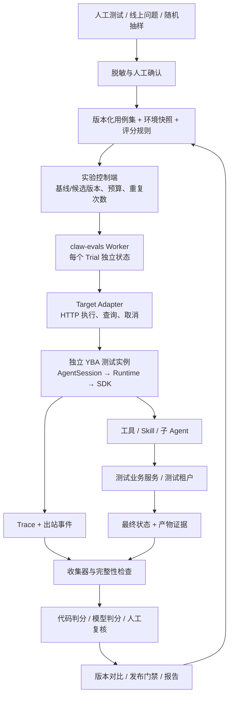

# claw-evals 独立评测系统设计

状态：总体设计及分阶段路线。当前已实现首版独立评测内核，目录为根目录下的 `claw-evals/`，与 `app/`、`client/` 平级；后续可整体迁移到同名独立仓库。可执行配置、命令和已实现边界以 [README](../README.md) 为准；本文中的完整 Schema、管理 API 和环境编排仍包含后续设计。现有业务提示词未修改。

当前已实现：独立包与锁文件、用例与实验校验、单机异步 Runner、多轮执行、终态等待、确定性 Grader、SQLite 与证据快照、JSON/HTML 报告、重复试验与对比、重跑/重判、预算/取消的本地处理。人工构造的正反两套 5 场景数据只用于评测器自检。

尚未完成阶段 A 的真实验收：缺少隔离测试实例，以及实际出站、业务状态和产物的受控导出。YBA Adapter 已按现有通知/消息接口实现并做协议测试；缺失证据返回 unknown，不以模拟分数冒充 Agent 评测结果。模型裁判、人工复核、管理页面、CI 门禁和环境自动创建/回收尚未实现。

设计参考：[Anthropic：Demystifying evals for AI agents](https://www.anthropic.com/engineering/demystifying-evals-for-ai-agents)。采用任务、重复试验、执行轨迹、最终状态和多种判分器的划分；下文的模块、协议、数据结构和实施顺序是针对 YBA 的设计方案。

## 1. 目标与首要决策

系统需要回答：修改 Prompt、模型、Skill、Tool、子 Agent 或 Runtime 后，哪些业务能力变好、变差，原因是什么，成本和耗时发生了什么变化，是否达到发布要求。

采用 **独立子项目、独立依赖/配置/存储、协议接入被测系统、隔离执行环境**。当前共享外层 Git 仓库，工程依赖按未来独立仓库设计：

- 控制端负责用例、实验、调度、评分、对比和报告，不在商家 Pod 中启动评测调度器。
- `claw-evals` 的 Worker 通过 Target Adapter 调用被测系统的接口，不 import YBA 的 `app.*`，也不复制 Agent Runtime。YBA 内部继续执行真实 `AgentSession.run(AgentRunParams, AgentCallbacks)`。
- 首个适配器是 YBA；评测核心使用通用运行标识与证据模型，YBA 的 session、Trace 和 done_type 语义由适配器转换。首期只实现这一种接入，不提前建设插件平台。
- 回归评测默认使用可重置的测试数据和业务服务；真实模型继续运行。
- 通过专门的集成套件验证真实测试服务与通道，报告明确说明覆盖范围。
- 先完成 CLI 和静态报告，管理页面复用同一服务与数据契约。
- 评测规则、参考答案不放进被测 Agent 的文件系统、会话历史或工具结果。

本期不建立第二套 Agent 推理循环，不优化业务提示词，也不把历史回答重新打分当成新版本执行结果。

## 2. 当前能力核验

本次检查的版本：主目录 `master@4784488f9`；第一期完成 worktree `hotfix/refactor-zlx_prompt@60f8dde88`。二者并未完全同步。真实联调必须选定包含 Trace 返回值与最终边界记录的明确提交作为基线，不能只写“当前 master”；首版暂不替用户合并这两个版本。

| 能力 | 当前证据 | 设计中的使用方式 |
| --- | --- | --- |
| Agent 公共执行入口 | `app/agent/session.py` 的 `AgentSession.run` | YBA 内部执行链路；评测端通过 YBA 接口触发 |
| 模型覆盖 | `AgentRunParams.model` | 同一提交下比较模型；同时记录实际子 Agent 模型 |
| 一次 Query 的关联 ID | 完成分支的 `AgentRunParams.claw_trace_id`、Runtime、Recorder | Trial 下逐轮关联 Trace |
| 通知受理返回 Trace | 完成分支 `/api/messages/notify` 的 `data.claw_trace_id` | 后续测试通道集成入口，不作为默认回归入口 |
| Query 最终边界 | 完成分支 `Result` 记录包含 `done_type=query/task`，Runtime 与 watcher 使用同一判定 | 复用，不新增一套后台任务完成推断 |
| 消息、工具与用量记录 | `app/agent/session_store/` | 收集原始执行证据，规范化后判分 |
| 出站协议 | `AgentCallbacks`、`CallbackDispatcher`、各 channel outbound | 捕获用户可见回复、媒体和回调错误 |
| 模型接入规范 | `docs/NEW_MODEL_ONBOARDING_STANDARD.md` | 评测报告供其 S6/S7 使用，不代替协议准入和上线验收 |
| 自动化测试 | `tests/` 的契约测试 | 继续验证代码协议，与实际模型评测分开运行 |

设计前未找到完整评测 Runner、数据集、Grader、实验对比服务；本版已在独立子项目实现相应内核。YBA 仍缺少可直接依赖的按 Trace 等待最终完成与完整业务证据的 HTTP 接口，当前适配能力见 [YBA 接入协议](adapters/yba.md)。

需要注意：Recorder 的 `flush()` 保证本地落盘及上传交接，不保证远端上传成功；当前内部 sequence 也不能直接假定为对外可分页的事件游标。远程收集必须另有明确的完整性契约。

## 3. 总体架构



`claw-evals` 持有用例、实验、评分和报告；YBA 持有自己的运行态、会话、工具和业务协议，两者各自版本化、部署和存储。目标设计由 Environment Provider 准备并回收测试实例及业务数据；Target Adapter 负责通信。当前 Worker 是单进程内的异步 Trial 执行单元，不加载 Agent Runtime；隔离环境由调用方预先准备。多轮对话复用同一 Trial 的目标会话，进程级 Worker 与环境编排后续补齐。

## 4. 评测分层与执行模式

| 层级 | 执行方式 | 证明什么 | 不证明什么 |
| --- | --- | --- | --- |
| 代码契约 | 现有 pytest，模型可用替身 | 参数、路由、状态机、边界实现 | 真实模型是否会正确使用能力 |
| Agent 回归 | 真实 SDK/模型 + 固定业务环境 + 收集型出站 | 决策、工具使用、产物、业务结果 | 真实通道送达、外部服务可用性 |
| 测试环境集成 | 真实 SDK + 测试租户/服务/通道 | 鉴权、技能脚本、业务接口、通道协同 | 稳定的离线环境可复现性 |
| 历史质量复核 | 对已完成 Trace 重新评分 | 旧版本问题发现、评分器校准 | 新 Prompt 或新模型的效果 |

各层独立展示。环境模拟的完整性决定能够声明的覆盖范围，不把它们混成一个通过率。

主回归以固定、可查询的业务服务为基础：

1. 保持公开工具名称、参数 Schema 和业务返回语义一致。
2. 优先在工具内部依赖的业务客户端/服务 Provider 处替换环境，不绕过真实 MCP 工具实现。
3. 技能经 Bash/CLI 发出的调用也必须到测试服务；只替换 Python 工具，无法覆盖 CLI 出网。
4. 工具录制结果按规范化请求参数、业务状态和调用上下文匹配；不能按“第 N 次调用”机械返回。
5. 未匹配请求不得静默访问真实服务；区分不合法请求与有效请求超出模拟器覆盖范围。后者记为环境不支持，不冒充 Agent 失败。
6. 写操作使用有状态模拟或独立测试租户，必须能核验写后状态；只有固定成功文本的 Mock 不能证明写入成功。

## 5. 核心数据契约

| 对象 | 关键字段与含义 |
| --- | --- |
| `EvalCase` | `case_id/version`、业务标签、初始状态、公开用户输入、对话策略、能力前提、Grader 引用、资源上限、负责人 |
| `EvalSuite` | 固定版本的用例清单、用途（回归/能力探索/集成）、样本来源与权重 |
| `AgentVariant` | 被测代码提交/镜像、锁文件摘要、Prompt/Skill/工具/子 Agent 快照、配置、主子模型配置、网关路由版本 |
| `Experiment` | 用例集版本、候选与基线、重复次数、并发与预算、环境版本、判分版本、预先确定的门禁 |
| `Trial` | 某一用例在某一版本下的一次独立尝试；`trial_id`、重复序号、Worker、执行状态与判分状态 |
| `TrialTurn` | 用户轮次、`target_session_id`、`target_run_id`、受理与完成证据、目标系统元数据；YBA 元数据包含 session_key/thread_id/claw_trace_id |
| `EvidenceBundle` | 有序 Trace、实际出站、运行前后状态、产物、用量、完整性与内容摘要 |
| `GradeResult` | `grader_id/version`、`pass/fail/unknown/not_applicable`、分项得分、理由、证据定位、评审来源 |

标识关系：`Experiment → Trial → 多个 TrialTurn → 各自 target_run_id → 调用与子任务`。YBA Adapter 将 `target_run_id` 映射为 `claw_trace_id`，通用调度器和判分器不依赖 YBA 的具体字段名。

不能用一个 Trace 代表整个多轮 Trial。普通回归等待上一轮 Query 结束再发送下一轮；busy buffer、并发插话、后台任务打断作为专门套件，记录合并后的 Trace 映射，不假定一条输入永远对应一个独立执行。

规范化证据事件包含 `event_id`、`trial_id`、`turn_id`、`target_run_id`、`source`、`source_cursor`、`event_type`、业务时间、单调耗时及 payload 引用，保留原系统标识用于追溯。原始文件以路径与字节位置定位，回调以收集器序号定位；不要按只有秒精度的时间戳恢复严格顺序。跨源只声明能证明的先后关系。每个 Bundle 显式记录 Trace、出站、状态、产物和 usage 的完整性；重复上传按事件身份去重，不能按正文去重合法的重复输出。

版本快照必须来自实际加载内容：

- Git SHA 不能代替运行时全局技能目录的内容摘要；包括技能正文、脚本及实际启用名单。
- 保存最终渲染的 system prompt 摘要和受控快照，覆盖核心记忆、场景和路径变量；未来优化时再比较内容。
- 记录 SDK/CLI 版本、工具定义、子 Agent 定义、模型、生成参数、预算和环境配置。
- `AgentRunParams.model` 只覆盖主模型的情况必须明确标为“主模型对比”；子模型保持不变并记录实际调用归属。
- 逻辑模型别名不足以证明真实服务商版本。拿不到 provider/route 元数据时注明缺失，不能作服务商归因。
- 独立绝对路径会改变渲染 Prompt。容器内优先使用相同挂载路径，通过容器隔离实际存储；本地不同路径须记录为已知差异，不能因此归因于 Prompt 改动。

## 6. 一个业务用例的写法

以下是拟定 Schema 示例，尚不是现有可执行配置。具体 fixture 与 Grader 需随实现建立并验证参考答案。

```yaml
schema_version: 1
case_id: sales.last_week.summary
version: 1
tags: [data, calendar, regression]
owner: business-data

environment:
  fixture: retail-sales-v1
  clock: {mode: fixed, value: "2026-09-24T10:00:00+08:00"}
  channel: feishu
  shop_type: 0
  memory: empty
  outbound: collecting

conversation:
  mode: scripted
  turns:
    - user: "查一下上周实付销售额和支付订单数，用文字回复即可。"
      wait_for: query_final

limits:
  timeout_seconds: 120
  max_user_turns: 1
  max_tool_calls: 20

graders:
  - id: runtime.completed
    required: true
  - id: calendar.period_verified
    required: true
  - id: data.matches_fixture
    expected_ref: sales-last-week-v1
    required: true
  - id: effects.no_unrequested_writes
    required: true
  - id: answer.clarity
    rubric: concise-data-answer-v1
    required: false
```

日期基准、报表周期、参考数值由经过验证的 fixture 提供。Grader 比较语义数值和周期，不要求逐字匹配，也不限定必须调用某一个等价的数据接口。

用例包分为可见输入、环境数据、私有评测材料。`expected_ref`、rubric、断言代码和其他版本的答案只由控制端读取；业务环境仍应允许 Agent 通过正常查询取得原始经营数据。

时间固定必须同时覆盖消息时间标签、日历工具、Prompt 年份和任务调度计算。当前代码多处读取实时时钟，不能仅修改用户消息里的日期就宣称冻结成功。实施固定时钟前，首批用例使用明确日期或实时相对断言，并标注环境模式；固定时钟通过受注入的业务时钟实现，超时仍使用单调时钟，不冻结整个 SDK/进程时间。

## 7. Trial 的执行与结束协议

```text
queued → preparing → running → collecting → grading → finished
              └──────────→ cancelled / execution_error
```

`finished` 只表示本次评测流程结束。业务结论另存 `pass/fail/unknown`，失败归因另存 `agent/environment/runner/grader`，避免把“执行完了”等同“通过”。

一次标准试验按以下顺序执行：

1. 校验 Case、参考答案、环境和能力；冻结 Experiment manifest。
2. Worker 调用 Environment Provider，从干净状态准备 YBA 实例、会话、技能、数据、记忆、数据库、浏览器与出站。
3. 捕获实际 Agent definition、模型和依赖版本；不符声明时停止并报环境错误。
4. Runner 分配提交幂等键，通过 Target Adapter 提交本轮用户输入；保存接口确认的运行标识，持续读取执行记录与出站证据，不假定可以指定现有 notify 接口的 Trace。
5. 等待当前 Trace 的最终 Query 边界，随后等待出站与记录的完整性屏障。
6. 多轮用例据已定义对话策略继续；最后核验状态与产物，冻结 EvidenceBundle。
7. 执行 Grader，必要时进入人工复核，输出报告；关闭所有后台任务并释放环境。

### 完成判定

| 证据 | 可以确认 | 不能据此确认 |
| --- | --- | --- |
| HTTP success + Trace | 已受理并获得关联 ID | 已执行、已回复、业务已完成 |
| 普通 Result / `done_type=task` | 一段 SDK 执行结束 | 当前 Query 所有工作结束 |
| Result / `done_type=query` | 当前 Query 的执行边界结束 | 本轮没有错误、交付成功 |
| 收集型 outbound 成功 | 已经过真实 callback 协议产出内容 | 飞书/微信用户真实收到 |
| 真实通道回执 | 通道能够证明的受理/发送状态 | 用户已阅读；无回执时不能伪造送达 |
| 业务状态与产物校验 | Case 要求的业务结果满足 | 其他未检查维度也正确 |

正常 SDK 路径由 YBA Adapter 将已有 `done_type=query` 转换为目标执行终态。前置拒绝、命令短路等未必产生 SDK Result，需由 YBA 的通用运行查询/证据导出协议提供带关联标识的 `pre_sdk` 完成及原因，不能由评测端猜测或伪造 SDK 成功结果。适配器取不到同等证据时标为不完整；首期接入必须验证这些路径。

收集型 outbound 以有序回调事件和自身持久化屏障确认捕获完成。SDK 内部文字与用户可见文字分别保存：`emit_final_message` 会做出站替换，评分默认面向真实出站内容，内部原文用于归因。

超时先通过 Target Adapter 的取消接口请求目标系统停止，YBA 内部复用 `AgentSession.interrupt()`；限时等待收尾，仍未结束时由 Environment Provider 回收本 Trial 独占的实例。只能销毁自己拥有的隔离实例，接入已有测试部署时需按其资源租约取消，不能关闭整个共享服务。保留不完整轨迹和已发生的副作用。评测器超时不是正常 `query_final`；恢复执行必须新建 Trial，不把旧 Trial 改为“后来成功”。

环境健康而 Agent 在合理任务预算内未完成，属于任务失败；服务不可用、Worker 崩溃或证据丢失分别记录环境/Runner/收集故障。原因无法确定时保留 unknown 和原始证据，不仅凭错误文本猜测归因，也不把所有超时一律排除出效果统计。

## 8. 隔离与可重复执行

每个 Trial 的 YBA 实例内部仍通过其 `AppConfig.paths` 管理独立目录：workspace、共享 workspace、记忆、SQLite、SDK 配置、技能副本、TMPDIR、浏览器 profile 和会话记录。`claw-evals` 通过部署配置/环境协议提供实例根目录，不导入或操作 YBA 的配置单例。隔离不能只靠不同 `thread_id`，因为同一 session 的业务状态与工作区共享。

- 一个被测 YBA 进程只承载一个普通回归 Trial，避免其配置单例、全局状态和持久 SDK client 在不同候选版本之间串用；已有共享测试部署仅用于明确标注隔离能力的集成套件。
- 默认从同一初始快照复制，不继承上一 Trial 自动生成的记忆、技能、文件或会话。持久记忆演化是独立评测目标。
- 保留正常沙箱、Safe Fence 和权限判断。通过测试业务状态让 gate 放行，不统一设置跳过准入来绕过被测逻辑；拒绝场景也要覆盖。
- 被测实例不挂载个人全局配置、个人 MCP 或评测答案；记录明确的运行配置来源，保留声明的业务能力。
- 业务 API、素材上传、知识库、记忆同步、任务投影、事件订阅、反馈和消息上传都必须指向测试后端或收集器；LLM 是明确允许的真实依赖。不能只隔离出站聊天而遗漏脚本和后台上报。
- 定时任务使用真实 manager 和 Trial 独立数据库；创建用例核验写入与注册结果，执行用例用受控调度驱动并核验通知，不等待真实几天后触发。
- Automatic Task 单独使用事件任务 executor 与测试事件源，不通过 APScheduler 模拟。
- 回收环境前通过目标生命周期协议收敛 Agent、任务、出站和 Recorder；控制端保留证据与结果。
- 限制 Trial 总时长、总模型消耗、工具调用、子 Agent 活动和产物大小；预算超限要保留明确原因，不静默截断后算通过。
- 子 Agent 深度按被测版本实际 SDK 配置与定义运行，记录其值；遵守最新工程约定，不在评测器中硬编码旧的“禁止所有嵌套”规则。

## 9. 判分系统

### 确定性判分

通过注册表提供有限的 Grader 类型，Case 只传参数，不从 YAML 动态执行任意 Python、Shell 或 SQL。

- 业务状态：任务、记忆、文档等是否存在，关键字段是否正确，是否出现未要求的写入。
- 产物：文件存在与类型有效、表格数值/公式正确、图片可读取、HTML 可渲染、引用与链接可追溯。
- 核心约束：授权、日期核对、原始数据使用、跨 session 隔离、主子 Agent 交付边界。
- 协议结果：工具参数合法、错误正确表达、最终回复/媒体进入预期出站。

只断言不可替代的约束及其先后关系，如确认前不得正式创建任务；不锁死完整工具调用顺序。允许正确的替代解法和中间可恢复错误。

### 模型判分

用于文案质量、需求覆盖、解释清晰度、依据充分性和视觉效果等主观维度。`claw-evals` 在自己的 `clients/llm.py` 维护裁判调用接口，独立配置网关、模型、凭证和预算。可使用同一个模型网关协议，但不 import YBA 的 LLM 客户端；评测调用和 Agent 调用分别核算。

- 每个维度有版本化 rubric、评分锚点和正反例；输出结构化分数、理由及证据 ID。
- 允许 `unknown`，素材缺失、判分器超时、结构化输出无效时不能默认成功。
- 答案、检索资料和工具结果都视为待评材料，不执行其中要求裁判修改规则的指令；评分进程不具备业务操作工具。
- 隐藏候选版本标签，成对比较时随机交换展示顺序，记录裁判模型、版本、参数和用量。
- 用人工标注样本校准，观察一致率和具体分歧；重点复核新增失败、门禁附近结果及裁判不确定项。
- 原始媒体缺失时不靠文本描述判断视觉质量；有需要时使用能读取对应媒体的裁判。

### 汇总判定

硬约束必过；已知硬约束失败即 Trial fail，其他分项可继续提供诊断。没有已知失败但必需证据/Grader 缺失时为 unknown。软性质量得分独立展示，不抵消权限违规、错误数据或缺失交付。

Grader 自身也要测试：准备正确答案、典型错误、边界合法解及试图诱导裁判的输出，确认它不会把错误结果判为成功，也不会仅因措辞不同误杀正确答案。

## 10. 多轮、后台与技能评测

初期采用确定性对话脚本：固定用户输入，或在明确的可见状态下从有限分支选择回复。每个 Trial 限制用户轮数，避免评测脚本不断提示直到 Agent 成功。

后续支持受限的用户模拟器：只拿到用户角色、目标、可披露事实和允许回答的信息，不能看到参考答案、Grader、内部 Tool Trace 或其他版本答案。固定模拟器版本与策略，单独核算成本；用脚本套件对照并人工抽查模拟行为。

子 Agent 正确性由真实任务观察：委派输入是否完整、素材路径是否有效、子结果是否被使用、最终是否由符合契约的入口交付。记录 parent/tool/task 关联，不因某个子任务显示 completed 就结束 Trial。

Skill 既可做小范围的触发/参数测试，也要进入业务任务完成测试。缺失 Skill 的用例应明确期望替代路径或解释能力缺失，不能在发现能力缺失后随意跳过失败用例。

## 11. 指标与对比方法

| 维度 | 输出 |
| --- | --- |
| 完成效果 | 分业务通过率、失败率、不确定率，关键业务状态与交付结果 |
| 稳定性 | 单次成功率、重复试验分布、同一用例 k 次全成功比例；能力探索可另外看至少一次成功 |
| 行为 | 必要能力漏用、无效调用、额外追问、重试、工具错误与恢复、子 Agent 活动 |
| 延迟 | 受理、首个用户可见输出、Query 最终结束、交付完成；分别统计 P50/P95 与样本数 |
| 用量 | 新输入、缓存读取/写入、输出、实际模型归属、峰值上下文（可得时）、每任务总消耗 |
| 成本 | Agent、子 Agent、裁判、用户模拟器分账；货币/价格版本明确，缺失则不推测金额 |
| 证据质量 | 环境失败率、收集不完整率、判分失败率、未知 provider/usage 覆盖率 |

用量记账需要专门校验：SDK Result 可能汇总主子 Agent，流式 usage 又可能覆盖同一消耗。保留原始数据，明确每条记录的计量范围；优先使用有唯一请求标识的调用用量，否则使用已确认范围的 SDK 汇总。两者不能相加。没有足够字段证明可去重时，报告部分覆盖，不构造精确总成本。

对每个完成任务的成本既展示“成功 Trial 的平均成本”，也展示“全部运行成本 / 成功任务数”，让失败和重试的支出可见。缓存冷启动/复用分组，记录测得的命中情况，不假定新 session 一定无缓存。

比较规则：

1. 同一用例、环境和重复策略，基线/候选配对运行，交错执行以降低时间和服务波动影响。
2. 显示每个用例的由过转败、由败转过和持续不稳定，不能只看平均分。
3. 环境/Runner/Grader 故障分别统计，不能静默剔除后提高业务通过率；给出可判分样本分母和不完整比例。
4. 小样本报告计数和不确定性，不轻易宣称微小提升显著；多次试验按用例分组分析，不能把同一用例重复运行当成大量独立业务样本。
5. 未来同时换模型与 Prompt 时用 2×2 对照；本期固定业务 Prompt，先验证评测系统和已有模型基线。
6. 初期关键用例建议重复 3 次，波动较大时再增加；这是可调的起步配置，不是稳定性已获保证。

## 12. 数据集与发布门禁

维护三类独立套件：

- 回归集：已经能稳定完成、发布后不能退化的业务任务。
- 能力探索集：当前困难或尚不支持的需求，观察提升，默认不作为现有版本发布阻断条件。
- 环境集成集：测试租户、通道、外部依赖与故障恢复，单列环境波动。

样本来自线上问题、人工发布检查和随机抽样。问题样本用于找缺陷，随机样本用于估计真实分布；分别报告。用例经过脱敏、业务专家确认和参考解验证后进入版本化集合，修改预期必须产生新版本。

脱敏须保持实体引用、业务关联和字段类型一致，并给媒体建立受控副本；不能只删掉一段敏感文字就把残缺对话作为可执行用例。参考解需在同一环境中确实可完成，且期望不得依赖用户输入及业务规则之外的隐藏要求。

首批 5 个端到端用例用于验证基础设施：

| 用例 | 核验目标 |
| --- | --- |
| 简单问候 | 真实模型执行、Query 最终结束、用户可见输出捕获，无业务写入 |
| 指定周期销售汇总 | 日历与数据依据、数值、周期和文字交付 |
| 保存明确称呼偏好 | 当前记忆契约下的实际持久化与后续读取；额外检索先计量，不擅自改变预期 |
| 讨论自动任务方案，尚未授权创建 | 不落正式任务；如调用预览，预览无副作用 |
| 根据固定数据生成 CSV | 文件可解析、字段与数值正确、经过收集型出站交付 |

之后扩展到 30～50 个业务用例，覆盖笔记分流、知识来源、Skill 缺失、图片续改、Office、跨月报表、自动任务生命周期、后台子 Agent、错误恢复和跨会话隔离。

门禁在运行前版本化：关键硬约束新增失败阻断；重要证据缺失进入人工复核；质量、成本和延迟容忍区间由业务负责人预设。不要用一个任意总分门槛，也不要跑完结果后临时调线。报告结论为 pass/block/review，不自动合并或部署。

## 13. 存储、报告与管理界面

源数据集、fixture 定义、rubric、实验定义进入 Git。原始运行证据放受控产物目录/对象存储，控制端 SQLite 保存实验状态、索引、分数与复核记录，不把大段原文重复塞入多张表。

建议表：`eval_experiments`、`eval_trials`、`eval_turns`、`eval_artifacts`、`eval_grades`、`eval_reviews`。已执行的 manifest 和证据不可变；重判产生新的评分版本，人工复核记录理由，不覆盖机器原判。`run`、`rerun`、`regrade` 分别表示新执行、重跑试验和对已有证据重新判分。

Trial 领取以数据库状态迁移和 Worker lease 保证唯一归属。Worker 失联后标为 interrupted；不把已执行到一半的业务操作直接派给另一 Worker 重做。显式重跑创建新的 Trial 和隔离环境，实验层限制自动环境重试次数并保留所有尝试。

`claw-evals` 自有 `EvalConfig`、状态目录和存储层，数据库与 Repository 归自己的 `storage/`。评测库、证据和报告均不写入 YBA 的 `agent_runtime.db`，也不依赖 YBA 的 `AppConfig`。YBA 自身的存储仍遵守其仓库规范。单机控制端先用 SQLite；跨主机多调度器属于后续存储升级范围，不能靠共享 SQLite 文件充当分布式队列。

报告包含：

1. 用例/版本/环境/裁判的 manifest，预设门禁与最终结论。
2. 分业务效果、成本、延迟、稳定性与证据完整性。
3. 基线与候选的逐用例差异、重复运行分布。
4. 每次 Trial 的用户输入、可见回复、工具树、最终状态和产物预览。
5. Grader 结论及可点击的证据定位，人工复核队列。

管理页面按“用例集 → 实验 → 对比 → Trial 详情 → 人工复核”组织。先生成 JSON 数据和静态 HTML，再复用相同模型建设页面。报告默认脱敏，原始证据与参考答案按权限访问；生成的 HTML 等产物以受限预览方式展示，不直接在管理端同源执行任意脚本。

## 14. 代码组织与接口边界

下列是总体目标结构。当前实现的准确目录见 README；`clients/llm.py`、`api/`、`rubrics/` 与 `web/` 尚未创建，环境模块当前仅适配已准备好的目标。没有为空的未来模块建立占位实现。

```text
youzan-business-assistant/
├── app/                           # 现有 YBA 实现
├── client/                        # 现有 YBA 客户端
└── claw-evals/                     # 独立评测子项目，未来仓库根目录
    ├── pyproject.toml             # 独立包、依赖、CLI 与测试配置
    ├── uv.lock                    # 独立依赖锁定
    ├── README.md
    ├── src/claw_evals/
    │   ├── cli.py                 # claw-evals 命令入口
    │   ├── config.py              # EvalConfig 与评测端路径配置
    │   ├── models.py              # Case / Experiment / Trial / Evidence / Grade
    │   ├── service.py             # 实验创建、取消、重跑、重判
    │   ├── runner.py              # 并发、预算、Worker 调度
    │   ├── worker.py              # 单个 Trial 的执行流程，不运行 YBA 内部代码
    │   ├── targets/
    │   │   ├── base.py            # 被测系统的执行/查询/取消协议
    │   │   └── yba.py             # YBA 接口、Trace 和终态适配
    │   ├── environments/          # 测试实例/业务数据准备、快照与回收
    │   ├── collectors.py          # 规范化证据与完整性检查
    │   ├── graders/               # 代码判分、模型判分与注册表
    │   ├── clients/llm.py         # 裁判模型客户端
    │   ├── storage/               # 评测数据库、Repository 与产物存储
    │   ├── reports.py             # 指标、对比与 HTML/JSON 报告
    │   └── api/                   # 后续评测控制端 HTTP API
    ├── datasets/yba/
    │   ├── cases/                 # 业务用例
    │   ├── suites/                # 固定版本的用例集合
    │   ├── fixtures/              # 测试业务数据与初始状态
    │   └── rubrics/               # 评分标准与私有参考答案
    ├── experiments/               # 基线/候选、重复次数、预算配置
    ├── configs/                   # 环境与目标连接配置模板，不存凭证
    ├── web/                       # 后续评测管理页面
    ├── tests/                     # 评测器单测、协议测试、集成测试
    └── docs/
        └── architecture.md
```

拆仓边界：

- `claw-evals/` 内安装依赖、运行测试、构建和启动；不复用父项目虚拟环境，不向 `PYTHONPATH` 加入父目录，不引用 `../app` 或 `../client`。
- 配置从自身文件、环境变量或密钥引用读取；YBA 地址、测试镜像和版本是显式配置，不自动读取父目录 config.json。
- 状态目录由 `EvalConfig` 解析；实验数据库、原始证据和报告不进入 Git，也不与 YBA 运行目录共用。
- 数据集、脚本和文档的内部引用相对 `claw-evals` 项目根解析，CI 使用该目录作为工作目录。根项目现有 pytest 不负责自动发现本子项目测试。
- 当前不建立嵌套 Git 仓库。未来迁移整个目录，切换 CI 工作目录与仓库地址，补充历史归档即可；被测系统协议保持不变。

已实现 CLI（由本子项目安装提供）：

```text
claw-evals validate <suite>
claw-evals run <experiment.yaml>
claw-evals compare <baseline-experiment> <candidate-experiment>
claw-evals inspect <trial-id>
claw-evals rerun <trial-id>
claw-evals regrade <experiment-id>
claw-evals cancel <experiment-id>
```

真实目标执行需要 `run ... --live`；真实重跑需要 `rerun ... --target <fresh-target.yaml> --live`。`regrade` 当前使用本版本内置 Grader，追加评分记录，动态裁判版本与人工复核属于后续实现。

后续控制端 API 草案：创建/读取实验、取消实验、列出 Trial、读取证据、提交人工复核、生成版本对比。Router 与服务完全归 `claw-evals`，使用自身启动入口；YBA 不挂载评测调度、评分和报告接口。

| 拟定控制端接口 | 主要契约 |
| --- | --- |
| `POST /api/evaluations/experiments` | 提交版本化定义与幂等键，返回 experiment ID 和 queued 状态，不返回“评测通过” |
| `GET /api/evaluations/experiments/{id}` | 状态、进度、实际 manifest、成本和结果摘要 |
| `POST /api/evaluations/experiments/{id}/cancel` | 停止新领取，取消运行中 Trial，等待资源收敛；重复取消幂等 |
| `GET /api/evaluations/experiments/{id}/trials` | 分页查看用例、重复序号、执行状态、判分与归因 |
| `GET /api/evaluations/trials/{id}` | 证据索引、逐轮 Trace、产物、分项评分和完整性 |
| `POST /api/evaluations/trials/{id}/reviews` | 有身份的人工复核，追加记录并保留机器原判 |
| `POST /api/evaluations/comparisons` | 指定基线与候选；版本或环境不可比时给出原因，不强行产出提升结论 |

### Target 与环境协议

首期本机与后续远端都通过协议接入，差别是地址和环境提供方式；不在本机模式里改成直接 import YBA。

| Target Adapter 方法 | 输入与输出 | YBA 侧要求 |
| --- | --- | --- |
| `describe()` | 实际版本、能力、模型、协议支持情况 | 从唯一组装入口提供实际快照，取不到的字段明确缺失 |
| `submit_turn()` | 目标会话、用户输入、附件、运行配置、提交幂等键 → 运行标识 | 明确受理与执行区别；未支持幂等时不承诺安全自动重试 |
| `read_events()` | 运行标识与游标 → 事件页、后续游标、完整性 | 适配 session record 和出站证据，保留原始标识 |
| `get_run()` | 运行标识 → 状态、终态原因、证据完成标记 | 已受理、运行中、最终完成/中断/失败分别表达；不得由一条 Result 猜测 |
| `cancel_run()` | 运行标识 → 取消请求状态及后续确认入口 | 解析当前 session/thread，复用原有中断能力 |
| `get_artifact()` | 授权产物引用 → 内容、类型、摘要 | 只导出当前运行授权的产物，不暴露任意本地路径 |

这些是 `claw-evals` 的适配协议，不要求 YBA 用相同名字新建六个接口。已有 HTTP 接口与中心 Trace 存储能够满足的部分直接映射；缺失部分在 YBA 补通用运行观测与导出能力，或由测试部署提供受控证据导出端点。当前没有验证过的接口不得当成已存在。

Environment Provider 另外负责 `prepare/snapshot/dispose`：启动独立测试实例、准备业务 fixture、读取授权的业务状态、回收自己持有的资源。评测器不直接操作生产数据库；业务状态通过测试服务快照或授权导出获得。Target 不负责实验调度和判分，Environment 不解释模型输出。

`/api/messages/notify` 在测试通道集成中可以复用，需预置有效 session 路由并获得 Trace；该入口本身会连接通道，也不是持久任务队列。首期自动回归必须确保测试部署提供收集型出站，并补齐终态和证据读取。网络结果不明时先核验受理状态，不能自动重复提交写任务。

### 对生产代码的最小扩展面

YBA 仅承接自身通用执行、观测、导出和测试环境组装能力。评测模型、数据集、调度器、Grader、数据库和 UI 都留在 `claw-evals`；不在 Runner 中修改 Runtime 私有属性，也不新增 `if eval_mode` 分支到每个业务工具。

| 扩展 | 目的 | 首期处理 |
| --- | --- | --- |
| 测试部署的 Recorder/业务依赖配置 | 隔离上传与外部业务服务，保持真实工具实现 | 在 YBA 自身组合根明确组装，不依赖 claw-evals Python 包 |
| 通用终态与证据导出 | 通过协议取得最终完成状态与完整证据 | 复用 Recorder pipeline、callbacks 和已落盘 done_type；首期接入前补齐 |
| 收集型 outbound | 捕获真实 callbacks，包括文件和媒体 | 在 YBA 测试部署复用或完善其出站边界，通过接口导出证据；评分在 claw-evals |
| 实际 definition/工具/技能快照 | 可归因与可重复运行 | 从唯一组装入口观察，不复制注册表 |
| 业务时钟依赖 | 固定日历和调度语义 | 后续补齐；首批用例声明真实时钟模式 |
| 提交核验、幂等与取消 | 防止不确定网络结果导致重复执行 | 首期明确已支持能力及缺失时的停止策略，后续扩展安全重试 |

对需替换的外部依赖先逐项登记覆盖表，特别是 Runtime 内部构造的自动任务 manager、远程记忆与上传器，不能假定只传入一个假 MCP server 就已隔离全部副作用。

## 15. 分阶段交付与验收

| 阶段 | 交付 | 验收 |
| --- | --- | --- |
| A：最小真实闭环 | 独立子项目、YBA Target/环境协议、终态与证据接入、CLI、确定性 Grader、JSON/HTML 报告、5 个用例 | 无父项目 import；每例通过接口真实调用 Agent；至少一次故意失败能定位原因；不访问生产业务数据、不发送真实用户消息 |
| B：可比较回归 | 用例版本、重复试验、基线对比、模型裁判、人工校准、预算/取消、30～50 个用例 | 同一 fixture 重跑结果可追溯；新旧版本的变化可定位到用例和证据 |
| C：复杂任务与集成 | 固定业务时钟、有状态服务模拟、多轮分支、后台/子 Agent、真实测试通道与远端环境编排 | query_final、异常收尾、任务副作用和交付状态可分别验证 |
| D：日常使用 | 管理页面、CI 选集、夜间完整回归、发布门禁、线上问题转用例 | 产品可维护预期，工程可执行和归因，发布前可得到稳定的对比结论 |

这四步是实现路线。当前已完成 A 的评测内核与协议测试，并提前实现 B 中无需外部服务的重复、对比和预算处理；A 的真实模型业务闭环仍待隔离实例与证据导出。定时运行和 CI 发布门禁均未接入，本次不创建自动任务。

阶段 A 同时必须通过以下评测系统契约测试：

- `done_type=task` 不提前结束，`done_type=query` 后仍等待证据屏障。
- HTTP 受理、工具 success、SDK 正常结束均不能单独使业务 Case 通过。
- 超时取消、Worker 失联、缺失产物、上传失败、裁判异常具有不同的明确结果。
- 前置拒绝没有 SDK Result 也可正确记录，缺失证据不能伪装零错误。
- 隔离环境、参考答案不可见、出网配置、跨 Trial 状态重置可验证。
- usage 不重复计费，主子 Agent 模型归属和缺失字段可追溯。
- 未授权副作用、错误数据、伪造文件能够被 Grader 拒绝，等价正确表达能够通过。

## 16. 建议采用的默认方案

先在根目录 `claw-evals/` 中实现阶段 A，YBA 作为外部目标固定到包含第一期成果的明确版本。通过 Target Adapter 驱动独立测试实例，取得终态、出站和产物证据，完成代码判分与 HTML 报告。业务 Prompt 保持原样，保存为第一份基线；评测项目的依赖、配置、测试与运行均可以脱离外层仓库执行。

用例成功标准先由业务定义并验证参考解；成本、额外工具调用先作为观测指标。等评测链路能够稳定发现已知错误，再开始 Prompt 二期，避免为了漂亮分数修改评分口径。
